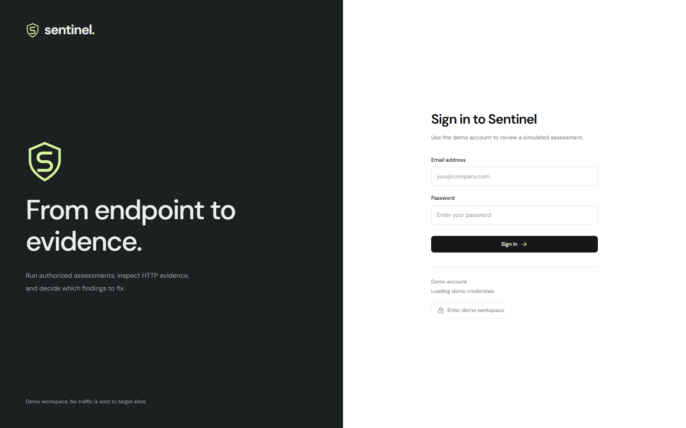
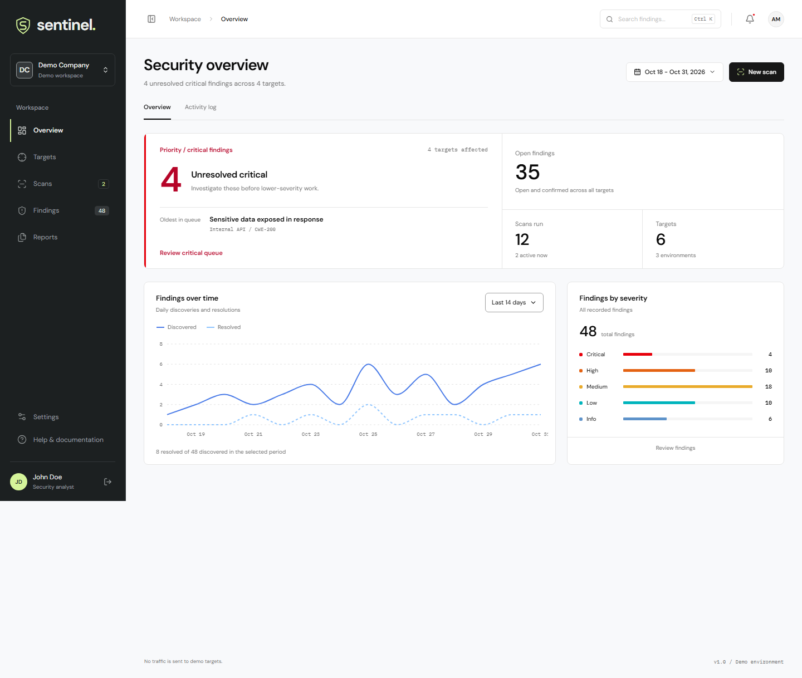
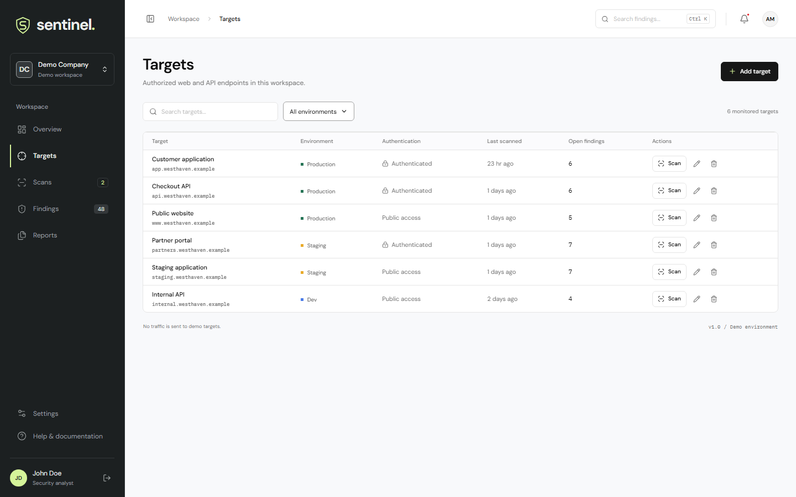
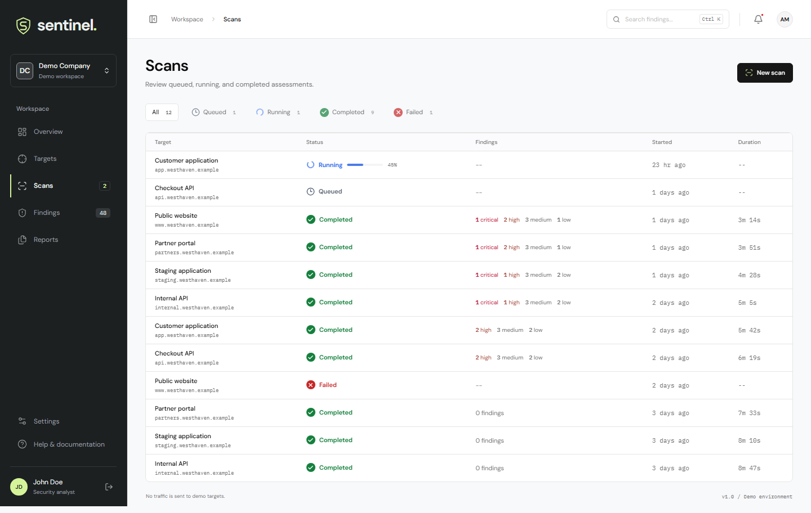
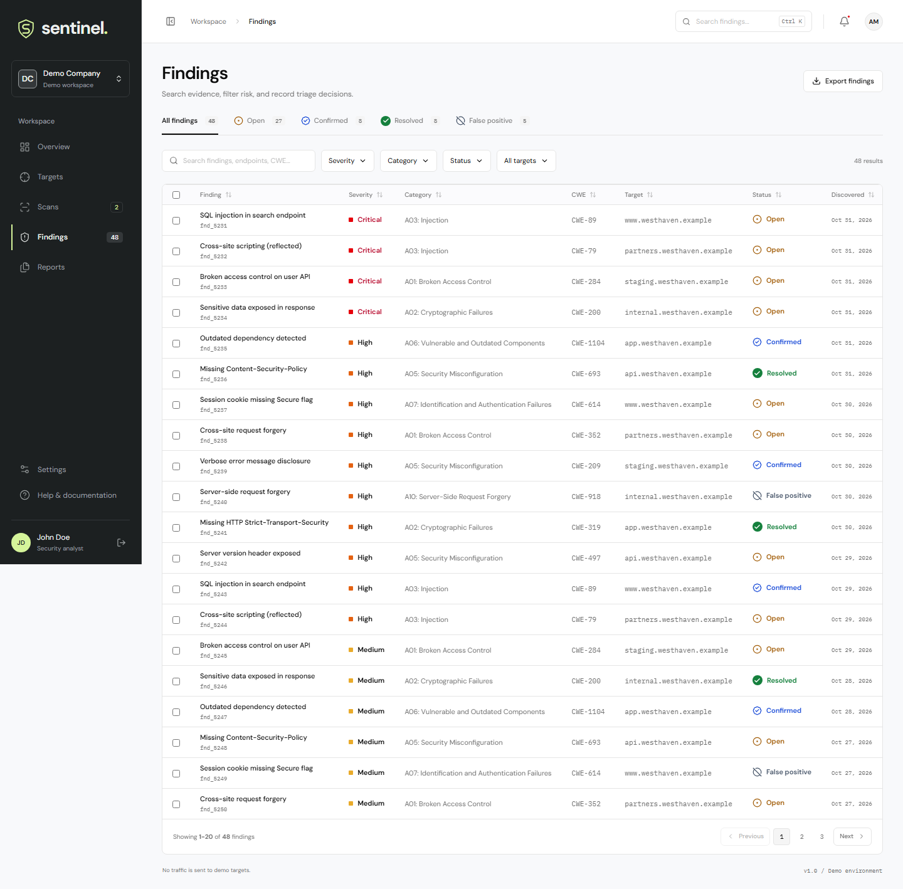
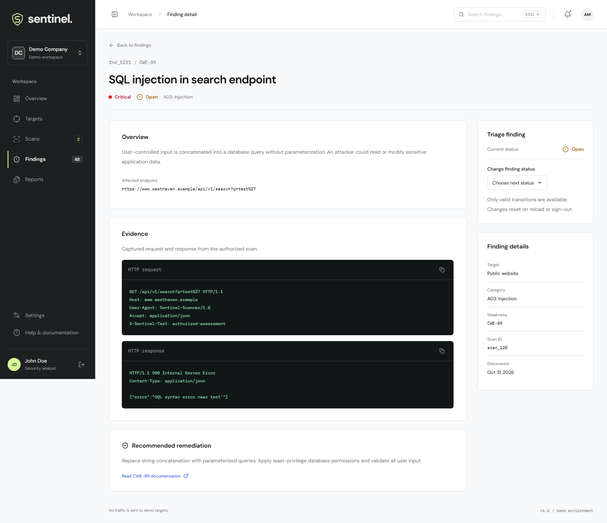
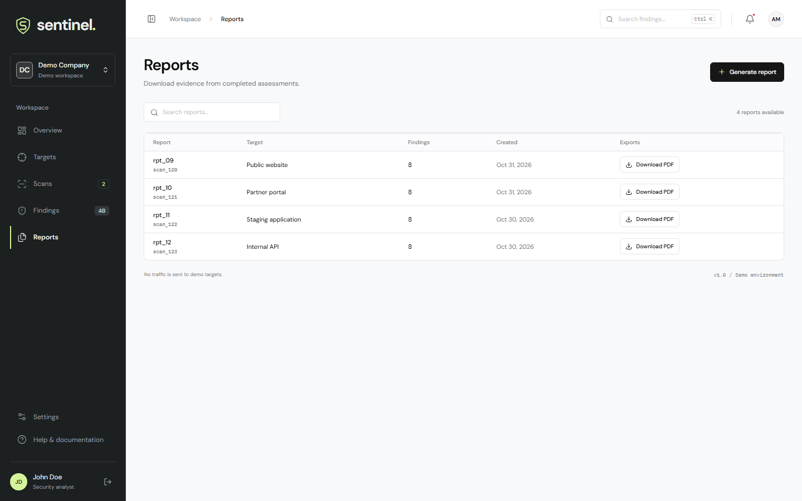
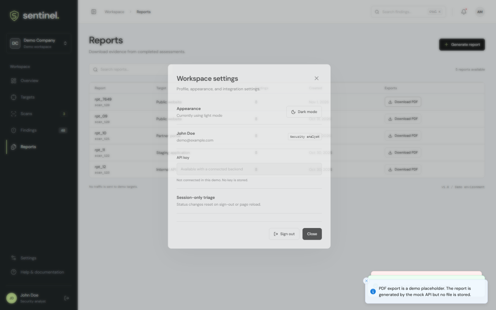

# Web Security Scanning Dashboard

A React 18 and TypeScript console for a security analyst to register authorized targets, launch simulated scans, triage findings, and generate report records. This is a frontend assignment demo: it does not scan live websites or send target credentials to an external service.

**Live demo:** [web-security-scanning-dashboard.vercel.app](https://web-security-scanning-dashboard.vercel.app)  
**Repository:** [Harshaseshasai/web-security-scanning-dashboard](https://github.com/Harshaseshasai/web-security-scanning-dashboard)

## Assignment Fit

| Assignment requirement      | Current implementation                                                                                                                                                                                              |
| --------------------------- | ------------------------------------------------------------------------------------------------------------------------------------------------------------------------------------------------------------------- |
| Login and protected screens | Demo login; protected dashboard, targets, scans, findings, finding detail, and reports routes.                                                                                                                      |
| Dashboard                   | Target/scan/finding KPIs, severity breakdown, findings-over-time chart, and recent scans.                                                                                                                           |
| Targets                     | Validated add/edit/remove flows; authenticated-scan credentials are validated and discarded by the mock.                                                                                                            |
| Scans                       | Queued/running/completed/failed states, timed progress, authorization confirmation, and completed-scan findings links.                                                                                              |
| Findings                    | URL-backed search, combined filters, sorting, pagination, row selection, CSV export, and triage. Filtering is client-side against the contract list.                                                                |
| Finding detail              | Description, location, request/response evidence, remediation, and session-only status transitions.                                                                                                                 |
| Reports and settings        | Report list, scan selection, generation retry, PDF placeholder, profile/theme/API-key settings. Settings is a modal, not a separate URL; this is a caveat if each screen is interpreted as requiring its own route. |
| Mock data and states        | 6 targets, 12 scans, and 48 findings; loading, empty, and error states; 300-800 ms simulated latency and a deliberate report-generation 503.                                                                        |

The core functional scope is implemented. Two strict-interpretation gaps remain: Tailwind 4 is configured, but most visual styling is authored in `src/index.css` rather than expressed utility-first; and Settings has no dedicated route. `vercel.json` provides the SPA rewrite for the deployed demo.

## Screens

The assignment groups Reports and Settings as screen 07; both views are shown below.

| 01 - Login                                                    | 02 - Dashboard                                                            |
| ------------------------------------------------------------- | ------------------------------------------------------------------------- |
|           |             |
| 03 - Targets                                                  | 04 - Scans                                                                |
|       |                         |
| 05 - Findings                                                 | 06 - Finding detail                                                       |
|  |  |
| 07 - Reports                                                  | 07 - Settings                                                             |
|      |   |

[Mobile dashboard screenshot](docs/screenshots/mobile.png) - [Mobile findings screenshot](docs/screenshots/mobile-findings.png) - [Dark reports screenshot](docs/screenshots/dark-reports.png)

## Navigation And Keyboard

The sidebar links navigate to `/dashboard`, `/targets`, `/scans`, `/findings`, and `/reports`. Finding rows open `/findings/:id`; direct visits to protected routes redirect to `/login`. Workspace, help, notification, and settings panels open dialogs.

- `Tab` and `Shift+Tab` move through links and controls; the skip link moves focus to the main content.
- `Enter` activates links and buttons. `Space` activates buttons and toggles native checkboxes.
- The custom select opens with `Enter`, `Space`, or an arrow key. `ArrowUp`/`ArrowDown` moves through enabled options, `Home`/`End` goes to the first/last option, `Enter`/`Space` selects, and `Escape` closes.
- Scan rows support `Enter` and `Space`. Filter popovers use native checkboxes.
- Dialogs trap focus while open, close with `Escape`, and restore focus to their trigger.
- Findings search/filter/sort/page state is represented in the URL so browser back/forward navigation restores the view.

`npm run test:browser` checks these workflows, captures the screenshots above, and writes the axe report to `docs/accessibility-audit.json`.

## Stack And State

React 18, TypeScript, Vite, Tailwind CSS 4, React Router, Radix primitives, TanStack Query, Zustand, Zod, MSW, Recharts, and Vitest. DM Sans is used for interface text; IBM Plex Mono is used for identifiers and HTTP evidence.

TanStack Query owns API-backed data and optimistic target mutations. Zustand owns session/theme/UI state and session-only finding status overrides. Findings filters, sorting, and page number are reflected in URL search parameters; the 48-row contract list is fetched from `GET /api/findings` and filtered client-side.

See [Architecture](docs/ARCHITECTURE.md), [API](docs/API.md), and [Design](docs/DESIGN.md) for implementation details.

## Setup And Verification

Node 20.19+ is required.

```sh
npm install
npm run dev
```

Use the demo account `demo@example.com` / `password123`, or select **Enter demo workspace**. The MSW worker is checked into `public/`. In development, requests use MSW; static preview builds use the same in-memory mock service unless `VITE_LIVE_API=true` is set for a real `/api` backend.

```sh
npm run check:conventions
npm run lint
npm run format:check
npm run typecheck
npm test
npm run coverage
npm run build
```

Coverage thresholds are configured at 90% for statements, branches, functions, and lines. The GitHub Actions quality workflow runs conventions, lint, formatting, typecheck, coverage, and build. The pre-commit hook runs the five local checks.

Run the browser workflow while Vite is running:

```sh
npm run test:browser
```

It defaults to `http://localhost:5173`; set `SMOKE_URL` to use another local origin.

## Known Limits

- The PDF action is a deliberate placeholder toast; no PDF bytes are generated or downloaded. Report metadata is returned by the mock API.
- The first report-generation request deliberately returns 503; retry succeeds.
- Mock mutations reset on reload. Target credentials are validated and discarded. Finding-status overrides are session-only.
- Authentication uses a fake demo token and is not a security boundary. Do not use this app with real targets or credentials.
- Tailwind is configured, but the project is not strictly utility-first; most layout and component styles are custom CSS.
- Settings is exposed as a modal rather than its own route.
