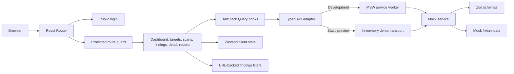

# Architecture

## Runtime Flow

The API adapter builds `/api` requests, adds the fake bearer token and optional idempotency key, parses successful responses with Zod, and converts error payloads into `Error` objects. In development, MSW forwards the request to the shared mock service. The production preview uses that same service unless `VITE_LIVE_API=true` selects `fetch` for a supplied backend.

## State Ownership

| State                                              | Owner                 | Lifetime                                                                             |
| -------------------------------------------------- | --------------------- | ------------------------------------------------------------------------------------ |
| Targets, scans, findings, reports                  | TanStack Query        | Cached for the current app session; mutations update or invalidate relevant entries. |
| Search, filters, sort, page                        | URL search parameters | Shareable and restored by browser navigation.                                        |
| Auth session, theme, modal, sidebar, selected rows | Zustand stores        | Client state; the theme persists, session-only state resets on sign-out.             |
| Form fields, modal-local errors, chart range       | React component state | Component lifetime.                                                                  |

The findings screen uses one cached findings query. Search, filters, sorting, and pagination are derived client-side with `filterFindings`, matching the assignment's `GET /api/findings` array contract. Finding-status overrides are applied over the fetched list without changing the mock API response.

## Routes

| Path            | Screen                                    |
| --------------- | ----------------------------------------- |
| `/login`        | Public login.                             |
| `/dashboard`    | Overview and activity tabs.               |
| `/targets`      | Target inventory and target dialogs.      |
| `/scans`        | Scan history and progress/detail dialogs. |
| `/findings`     | Searchable, filterable findings table.    |
| `/findings/:id` | Finding detail and triage.                |
| `/reports`      | Report list and generation.               |

The Settings view is currently a shell modal, not a separate route. All routes except `/login` are under the auth guard.

## Mutations

Target create, update, and delete use optimistic cache updates with rollback on failure. Scan creation and report generation publish returned entities to their query caches, then invalidate the relevant query. Idempotency keys protect retryable create operations in the mock service. Mock data is in memory and resets on page reload.

## Validation

Zod schemas validate fixture data, API responses, and mutation bodies. Vitest covers schema and filter behavior, API/auth flows, state transitions, and data states. `scripts/browser-smoke.mjs` verifies browser workflows, keyboard flows, responsive overflow, and axe rules, and writes screen captures to `docs/screenshots/`.
