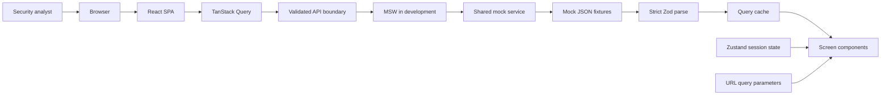

# Architecture

## System Context

The production demo transport bypasses MSW but uses the same service and response schemas. In live-API mode, the browser sends requests to the real `/api` endpoints. There is no service worker import in the production entry point.

## Component Hierarchy

`App` owns QueryClient, BrowserRouter, the shared tooltip provider, and the global toaster. `AppRoutes` declares real URLs. `ProtectedRoute` evaluates the current session. `AppShell` owns the responsive navigation, header, content landmark, footer, refresh indicator, and modal host. Each page owns its screen's read model. Feature components own tables or mutation forms; `components/ui` owns locally editable Radix-based primitives.

`FindingsPage` composes `useFindings`, `useFindingsFilter`, `filterFindings`, `FilterMenu`, and `FindingsTable`. The page coordinates filters and selection. The pure filter function combines the conditions, sorts a copy, and slices pagination. `FindingsTable` owns semantic rows and keyboard interactions, not the API.

`GlobalModals` routes the active modal to `TargetForm`, `ScanForm`, or `ReportForm`. Mutation forms validate before mutation, lock against duplicate events, expose pending states, and preserve inline errors.

## Data Flow

1. A query creates an authenticated `Request` via `lib/api.ts`.
2. MSW intercepts it in development and delegates to the shared mock service.
3. The service simulates 300-800 ms latency, validates mutation input, and returns a response.
4. The API boundary checks HTTP success and strictly parses the JSON using Zod.
5. TanStack Query caches only validated objects and owns fetching/error state.
6. `useFindings` overlays session-only Zustand triage statuses without mutating cached server responses.
7. URL filters derive the visible rows; components render them.

The diagram intentionally does not imply that all server data is copied into Zustand. Only client-owned overrides are merged with the query result. Add/edit/delete target mutations use optimistic snapshots and rollback. Reports retain one idempotency key across retry.

## Routes

| URL             | Component                   | Protected                           |
| --------------- | --------------------------- | ----------------------------------- |
| `/login`        | LoginPage                   | No; authenticated sessions redirect |
| `/`             | Redirect to `/dashboard`    | Yes                                 |
| `/dashboard`    | DashboardPage               | Yes                                 |
| `/targets`      | TargetsPage                 | Yes                                 |
| `/scans`        | ScansPage                   | Yes                                 |
| `/findings`     | FindingsPage                | Yes                                 |
| `/findings/:id` | FindingDetailPage           | Yes                                 |
| `/reports`      | ReportsPage                 | Yes                                 |
| Unknown URL     | Dashboard or login redirect | Session-dependent                   |

`/scans?scan=scn_003` opens a shareable scan-detail dialog. `/findings?scan=scn_003` adds an optional scan scope alongside the four required filter dimensions.

## State Ownership

| Owner                 | State                                                                        |
| --------------------- | ---------------------------------------------------------------------------- |
| URL parameters        | Search, severity/category/status arrays, target, scan, sort, direction, page |
| TanStack Query        | Targets, scans, findings, individual findings, reports, mutation lifecycle   |
| Zustand auth          | Validated session; sessionStorage persists tab authentication                |
| Zustand theme         | Theme; localStorage key exactly `theme`; root `dark` class                   |
| Zustand triage        | Session-only finding-status overrides                                        |
| Zustand UI            | Sidebar, mobile navigation, modal, selected rows                             |
| Local component state | Draft search, form validation, date window, transient target-delete dialog   |
| Mock service          | In-memory entities, scan clocks, idempotency results, first-report failure   |

Scan progress is computed from a service-owned clock in one-percent increments per 800 ms and polled while work is active. This section 8.3 implementation avoids divergent progress when the same scan appears on multiple screens. The cache and all visible progress bars use the same source of truth.
